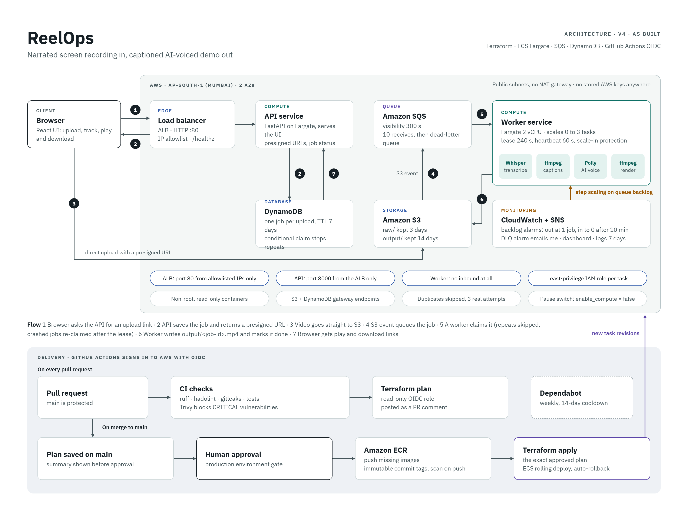

# ReelOps

[](https://github.com/shreyas0917/reelops/actions/workflows/ci.yml)
[](https://github.com/shreyas0917/reelops/actions/workflows/terraform.yml)

**Narrated screen recording in, captioned AI-voiced demo out.** A queue-driven
video pipeline on AWS Fargate, built and deployed entirely with Terraform and
GitHub Actions, and tested with failure drills against the live stack.



## Demo

Demo video coming soon.

## What it does

Upload a narrated screen recording (MP4, MOV or WebM, up to 200 MB). A worker
transcribes the narration with Whisper, burns in captions, re-voices it with
Amazon Polly in time with the video, and renders a new MP4. The web UI tracks
each job and plays the result above a caption track that follows playback.


## Results

| Metric | Result | Source |
| --- | --- | --- |
| Processing speed | 2-minute recording in 16 s; 41-minute recording in 20 min | [failure tests](docs/failure-tests.md) 1 and 6 |
| Autoscaling | 0 → 3 workers on an 8-job burst, back to 0 after 10 idle minutes | [learning notes](docs/learning-notes.md), Phase 5 load test |
| Concurrency test | 8 jobs submitted to an idle stack: all done 233 s after the first upload (first worker started at 202 s) | same load test (`scripts/load_test.sh`) |
| Idle cost | ~$0.05/hour with workers at 0; ~$0.10/month paused | [cost](#cost) below |
| Failure drills | 8 of 8 pass, against the live stack | [failure tests](docs/failure-tests.md) |
| Infrastructure | 77 Terraform-managed resources (70 + 7 bootstrap) | `terraform state list` |

## How it works

**Upload → S3 → SQS → Fargate worker → Whisper → Polly → FFmpeg → S3**

1. The browser asks the API for an upload link; the API records the job in
   DynamoDB and returns a presigned S3 URL, so video bytes never touch the API.
2. The upload's S3 event lands in SQS; an autoscaled worker claims the job.
3. The worker transcribes (Whisper), captions and re-voices (Polly), renders
   (FFmpeg), and writes the result back to S3.

| Mechanism | What it guarantees |
| --- | --- |
| Lease + heartbeat | A job is claimed with a conditional DynamoDB write; a 60 s heartbeat keeps the 240 s lease alive, so a crashed worker's job is taken over, never lost or run twice. |
| Real-attempt limit + DLQ | A job is given up after 3 real attempts (the user sees "failed", an alarm emails); a message no worker can handle goes to a dead-letter queue after 10 receives, which also alarms. |
| Scale-in protection | A worker marks its ECS task protected while it holds a job, so scale-in stops idle workers only. |

## CI/CD and security

| Control | How |
| --- | --- |
| No stored AWS keys | GitHub Actions signs in with OIDC; locally, an EC2 instance role. |
| Secrets scanning | gitleaks on every PR, over the full git history. |
| Image scanning | Trivy fails CI on CRITICAL vulnerabilities; ECR scans on push. |
| Plan review | Every PR gets the Terraform plan as a comment (read-only role). |
| Gated deploy | Merges to `main` save a plan; a human approves it in the `production` environment before it is applied. |
| Least-privilege IAM | One role per task and per CI job; the deploy role can't change its own permissions. |
| Hardening | SHA-pinned actions, non-root read-only containers, ALB reachable only from allowlisted IPs, workers accept no inbound traffic. |

## Bugs found and fixed

Found by the failure drills and by reviewing plans; details in
[docs/failure-tests.md](docs/failure-tests.md).

| Bug | Found by | Fixed in |
| --- | --- | --- |
| Harmless SQS receives (scale-in releases, crashes) used up a job's retry budget | Drill 1b: worker crash | PR #9 |
| Unreadable uploads showed raw ffprobe output, with a temp path, to users | Drill 3: poison input | PR #9 |
| A brief API outage showed a running job as failed in the UI | Drill 5: API task stopped | PR #9 |
| A stale local tfvars file made plans roll both services back to old images | A pause plan | PR #11 |
| Jobs that gave up no longer reached any alarm | Reviewing PR #9's trade-off | PR #13 |

## Trade-offs and production upgrades

| Today (dev) | Why | Production upgrade |
| --- | --- | --- |
| HTTP on port 80 | No domain, so no TLS certificate | Domain + ACM certificate, HTTPS listener, WAF |
| IP allowlist on the ALB | The API has no user authentication | User sign-in (e.g. Cognito); then open to the internet |
| One region, two AZs | Enough for a demo | Multi-region only if the users need it |
| No NAT gateway; public IPs on tasks | Avoids NAT's hourly cost; security groups block all inbound | Private subnets with NAT or interface endpoints |
| One API task | Replacing it gave a 20 s outage (drill 5) | Two API tasks across AZs |
| Workers scale from 0 | Zero idle compute cost; the first job waits ~3 min | One warm worker in working hours |

Next: authentication and HTTPS, per-user job lists, and alarms on the API's
5xx rate and latency.

## Cost

Approximate on-demand prices in ap-south-1 (estimates from the build notes;
check AWS pricing).

| State | Cost | What runs |
| --- | --- | --- |
| Processing | ~$0.16/hour | Worker (2 vCPU), API, ALB, 4 public IPs |
| Idle | ~$0.05/hour | API, ALB, 3 public IPs; workers at 0 |
| Paused | ~$0.10/month | Storage only: ECR images, S3, DynamoDB, SQS, logs |

The pause switch removes the ALB and both services and keeps all data:

```bash
terraform -chdir=terraform/main apply -var enable_compute=false   # pause
terraform -chdir=terraform/main apply                             # resume
```

## Deploy it yourself

**Prerequisites:** an AWS account, AWS CLI v2 with credentials (an SSO profile
or instance role; no access keys needed), Terraform 1.10 or newer, Docker,
git, bash and python3. Everything runs in `ap-south-1`.

```bash
# 1. Bootstrap: the S3 bucket for Terraform state (local state, once)
terraform -chdir=terraform/bootstrap init
terraform -chdir=terraform/bootstrap apply

# 2. Configure (terraform.tfvars is git-ignored)
cp terraform/main/terraform.tfvars.example terraform/main/terraform.tfvars
```

```hcl
# terraform/main/terraform.tfvars: placeholders, use your own values
alert_email   = "<your-email>"        # alarm emails; confirm the subscription AWS sends
allowed_cidrs = ["<your-ip>/32"]      # who may reach the ALB on port 80
```

```bash
# 3. Init against the state bucket (its name contains your account ID)
terraform -chdir=terraform/main init \
  -backend-config="bucket=reelops-tfstate-$(aws sts get-caller-identity --query Account --output text)"

# 4. Image repositories first, then build and push both images
terraform -chdir=terraform/main apply -target='aws_ecr_repository.this'
scripts/push_images.sh

# 5. Everything else (image tags are computed from the commit)
terraform -chdir=terraform/main apply
terraform -chdir=terraform/main output api_url

# Pause / resume
terraform -chdir=terraform/main apply -var enable_compute=false
terraform -chdir=terraform/main apply

# Tear down: empty the media bucket first (destroy keeps non-empty buckets);
# the state bucket itself is kept (prevent_destroy)
aws s3 rm "s3://$(terraform -chdir=terraform/main output -raw media_bucket_name)" --recursive
terraform -chdir=terraform/main destroy
```

To run the CI/CD pipeline in a fork, set the `github_repo`, `github_owner_id`
and `github_repo_id` variables in `terraform.tfvars`, then add the role ARNs
and settings as repository secrets and variables (learning notes, Phase 7).

## Repo layout

| Path | Purpose |
| --- | --- |
| `app/` | FastAPI API (serves the web UI) |
| `worker/` | Transcription, voice-over and FFmpeg rendering |
| `frontend/` | React web UI |
| `terraform/bootstrap/` | One-time: Terraform state bucket |
| `terraform/main/` | All other infrastructure |
| `scripts/` | Image tags and pushes, load test, failure drills (`chaos/`) |
| `.github/workflows/` | CI and the Terraform plan/deploy pipeline |

**Docs:** [failure tests](docs/failure-tests.md) ·
[learning notes](docs/learning-notes.md) (every step, with the reasoning and
problems hit) · [autoscaling chart](docs/scaling.png) ·
[architecture](docs/architecture.png)
