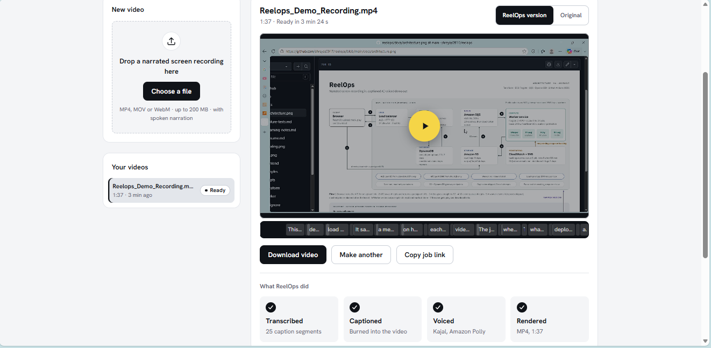

# ReelOps

[](https://github.com/shreyas0917/reelops/actions/workflows/ci.yml)
[](https://github.com/shreyas0917/reelops/actions/workflows/terraform.yml)

**Narrated screen recording in, captioned AI-voiced demo out.** A queue-driven
video pipeline on AWS Fargate, built and deployed entirely with Terraform and
GitHub Actions, and tested with failure drills against the live stack.


## Demo

[](https://drive.google.com/file/d/1PyBVqyqM5OU3Vl-X_dI9V6aodf-QcjPB/view)

▶ [Output video](https://drive.google.com/file/d/1PyBVqyqM5OU3Vl-X_dI9V6aodf-QcjPB/view): my narrated architecture walkthrough after ReelOps (captions + AI voice)<br>
▶ [Screen recording](https://drive.google.com/file/d/19bUYDmQv8vKxHVwG3bW3zZKAovY4pwdh/view): uploading that walkthrough and watching it process

- "Ready in 3 min 24 s" includes a cold start (workers scale from zero);
  processing on a running worker is ~33 s.
- Captions use Whisper's base model, which sometimes mishears AWS names
  (e.g. DynamoDB); a domain word list for Whisper is a planned improvement.

## What it does

Upload a narrated screen recording (MP4, MOV or WebM, up to 200 MB). A worker
transcribes the narration with Whisper, burns in captions, re-voices it with
Amazon Polly in time with the video, and renders a new MP4. The web UI tracks
each job and plays the result above a caption track that follows playback.


## Results

| Metric | Result | Source |
| --- | --- | --- |
| Processing time | A real 2-minute screen recording is processed in 33 s on a running worker (worker pipeline only; excludes upload and queue wait) | [learning notes](docs/learning-notes.md), "Processing time" |
| Upload to ready | Within 13 s for a 31 s recording with a worker running; from idle, add ~200 s for the first worker to start | [failure tests](docs/failure-tests.md) 2; Phase 5 load test |
| Autoscaling | 0 → 3 workers on an 8-job burst, back to 0 after 10 idle minutes | [learning notes](docs/learning-notes.md), Phase 5 load test |
| Concurrency test | 8 jobs submitted to an idle stack: all done 233 s after the first upload (first worker started at 202 s) | same load test (`scripts/load_test.sh`) |
| Idle cost | ~$0.05/hour with workers at 0; ~$0.10/month paused | [cost](#cost) below |
| Failure drills | 8 of 8 pass, against the live stack | [failure tests](docs/failure-tests.md) |
| Infrastructure | 77 Terraform-managed resources (70 + 7 bootstrap) | `terraform state list` |

## How it works

**Upload → S3 → SQS → Fargate worker → Whisper → Polly → FFmpeg → S3**

1. The browser asks the API for an upload link; the API records the job in
   DynamoDB and returns a presigned S3 URL, so video bytes never touch the API.
2. The upload's S3 event lands in SQS; an autoscaled worker claims the job.
3. The worker transcribes (Whisper), captions and re-voices (Polly), renders
   (FFmpeg), and writes the result back to S3.

| Mechanism | What it guarantees |
| --- | --- |
| Lease + heartbeat | A job is claimed with a conditional DynamoDB write; a 60 s heartbeat keeps the 240 s lease alive, so a crashed worker's job is taken over, never lost or run twice. |
| Real-attempt limit + DLQ | A job is given up after 3 real attempts (the user sees "failed", an alarm emails); a message no worker can handle goes to a dead-letter queue after 10 receives, which also alarms. |
| Scale-in protection | A worker marks its ECS task protected while it holds a job, so scale-in stops idle workers only. |

## CI/CD and security

| Control | How |
| --- | --- |
| No stored AWS keys | GitHub Actions signs in with OIDC; locally, an EC2 instance role. |
| Secrets scanning | gitleaks on every PR, over the full git history. |
| Image scanning | Trivy fails CI on CRITICAL vulnerabilities; ECR scans on push. |
| Plan review | Every PR gets the Terraform plan as a comment (read-only role). |
| Gated deploy | Merges to `main` save a plan; a human approves it in the `production` environment before it is applied. |
| Least-privilege IAM | One role per task and per CI job; the deploy role can't change its own permissions. |
| Hardening | SHA-pinned actions, non-root read-only containers, ALB reachable only from allowlisted IPs, workers accept no inbound traffic. |

## Bugs found and fixed

Found by the failure drills and by reviewing plans; details in
[docs/failure-tests.md](docs/failure-tests.md).

| Bug | Found by | Fixed in |
| --- | --- | --- |
| Harmless SQS receives (scale-in releases, crashes) used up a job's retry budget | Drill 1b: worker crash | PR #9 |
| Unreadable uploads showed raw ffprobe output, with a temp path, to users | Drill 3: poison input | PR #9 |
| A brief API outage showed a running job as failed in the UI | Drill 5: API task stopped | PR #9 |
| A stale local tfvars file made plans roll both services back to old images | A pause plan | PR #11 |
| Jobs that gave up no longer reached any alarm | Reviewing PR #9's trade-off | PR #13 |

## Trade-offs and production upgrades

| Today (dev) | Why | Production upgrade |
| --- | --- | --- |
| HTTP on port 80 | No domain, so no TLS certificate | Domain + ACM certificate, HTTPS listener, WAF |
| IP allowlist on the ALB | The API has no user authentication | User sign-in (e.g. Cognito); then open to the internet |
| One region, two AZs | Enough for a demo | Multi-region only if the users need it |
| No NAT gateway; public IPs on tasks | Avoids NAT's hourly cost; security groups block all inbound | Private subnets with NAT or interface endpoints |
| One API task | Replacing it gave a 20 s outage (drill 5) | Two API tasks across AZs |
| Workers scale from 0 | Zero idle compute cost; the first job waits ~3 min | One warm worker in working hours |

Next: authentication and HTTPS, per-user job lists, alarms on the API's
5xx rate and latency, and tuning the existing Whisper hotword hint with AWS
terms.

## Cost

Approximate on-demand prices in ap-south-1 (estimates from the build notes;
check AWS pricing).

| State | Cost | What runs |
| --- | --- | --- |
| Processing | ~$0.16/hour | Worker (2 vCPU), API, ALB, 4 public IPs |
| Idle | ~$0.05/hour | API, ALB, 3 public IPs; workers at 0 |
| Paused | ~$0.10/month | Storage only: ECR images, S3, DynamoDB, SQS, logs |

The pause switch removes the ALB and both services and keeps all data:

```bash
terraform -chdir=terraform/main apply -var enable_compute=false   # pause
terraform -chdir=terraform/main apply                             # resume
```

## Deploy it yourself

This builds the whole ReelOps stack in your own AWS account. You don't need
to know Terraform: copy each step and check the "you should see" line before
moving on.

> **Cost:** about $0.05/hour while running and idle, about $0.16/hour while
> processing, and about $0.10/month when paused (step 8). Pause or destroy it
> when you're done.

### What you need

| Tool | Why | Check it's installed |
| --- | --- | --- |
| An AWS account | Where everything runs | You can sign in to the AWS console |
| AWS CLI v2 | Lets your terminal talk to AWS | `aws --version` |
| Terraform 1.10+ | Builds the infrastructure from code | `terraform version` |
| Docker 23+ (with BuildKit) | Builds the API and worker images | `docker ps` (no error) |
| git, bash, python3, curl | Scripts | `git --version` |
| ffmpeg (optional) | Only for the test video and test script in step 7 | `ffmpeg -version` |

**Sign the CLI in to AWS without access keys.** Use one of these:
- **IAM Identity Center (SSO):** `aws configure sso`, then `aws sso login`
- **An EC2 instance with an IAM role** (what this project used)

Check it works:
```bash
aws sts get-caller-identity
```
**You should see** your account number and user or role name. If you get an
error, fix this first; nothing else will work.

Everything is created in **`ap-south-1` (Mumbai)**.

### Step 1: Get the code
```bash
git clone https://github.com/shreyas0917/reelops.git
cd reelops
```
Use a normal (full) clone: image tags come from the git history, so a
`--depth 1` clone won't work.

### Step 2: Create the Terraform state bucket (once)
Terraform remembers what it built in a "state" file. This step creates a
private S3 bucket to keep that file safe.
```bash
terraform -chdir=terraform/bootstrap init
terraform -chdir=terraform/bootstrap apply
```
Terraform shows what it will create and asks `Enter a value:`. Type **yes**.
**You should see:** `Apply complete! Resources: 7 added`

### Step 3: Add your settings
```bash
cp terraform/main/terraform.tfvars.example terraform/main/terraform.tfvars
```
Open `terraform/main/terraform.tfvars` and fill in:
```hcl
alert_email   = "you@example.com"     # where alarm emails go
allowed_cidrs = ["203.0.113.10/32"]   # your public IP, with /32 on the end
```
- **Your public IP:** run `curl -s https://checkip.amazonaws.com`.
- **Why the IP:** the app has no login, so only your IP can open it.
- `terraform.tfvars` is git-ignored, so your values never get committed.

### Step 4: Connect Terraform to the state bucket
```bash
terraform -chdir=terraform/main init \
  -backend-config="bucket=reelops-tfstate-$(aws sts get-caller-identity --query Account --output text)"
```
Only the bucket is needed here; the state file's key and region are already
in `terraform/main/backend.tf`.
**You should see:** `Terraform has been successfully initialized!`

### Step 5: Create the image repositories, then build and push the images
The app runs as two Docker images (API and worker). They need somewhere to
live (ECR) before AWS can run them.
```bash
terraform -chdir=terraform/main apply -target='aws_ecr_repository.this'
scripts/push_images.sh
```
Type **yes** when asked; Terraform warns that `-target` is for exceptional
cases, which this is.
- `push_images.sh` logs in to ECR itself, builds both images for
  `linux/amd64` (Fargate's platform; on an ARM laptop the build is emulated
  and slower), pushes them, then waits up to 3 minutes per image for ECR's
  vulnerability scan.
- The worker image is about 480 MB because it includes the Whisper speech
  model.
- It refuses to run if `app/`, `frontend/` or `worker/` have uncommitted
  changes, so every tag matches the code inside the image.

**You should see:** `images ready: api=<7 characters> worker=<7 characters>`,
then a vulnerability count for each new image.

### Step 6: Build everything else
```bash
terraform -chdir=terraform/main apply
```
Read the plan, then type **yes**. This creates about 70 resources and waits
until the load balancer and services are healthy.
**You should see:** `Apply complete! Resources: ... added`

**Then check your email.** AWS sends *"AWS Notification - Subscription
Confirmation"*. Click **Confirm subscription**, or you won't get alarm
emails.

### Step 7: Open the app and make your first video
```bash
terraform -chdir=terraform/main output api_url
```
Open that URL in your browser and upload a short screen recording where you
speak while recording.

- **The first job waits about 3 minutes**, because workers start from zero to
  save money. After that, a 2-minute recording takes about 33 seconds to
  process.
- **No recording handy?** Make a 30-second test video, then run a full
  upload-to-download test from the terminal:
  ```bash
  scripts/make_sample.sh        # writes samples/synthetic.mp4 (needs ffmpeg)
  scripts/env_from_tf.sh        # writes .env from Terraform's outputs (e2e.sh reads it)
  API_URL="$(terraform -chdir=terraform/main output -raw api_url)" scripts/e2e.sh
  ```

### Step 8: Pause when you're done (keeps your data)
```bash
terraform -chdir=terraform/main apply -var enable_compute=false   # pause
terraform -chdir=terraform/main apply                             # resume later
```
Pausing removes the load balancer and running services and keeps your videos,
images and settings, so the cost drops to about $0.10/month. While paused
there is no app URL; resuming creates a new load balancer with a new one.

### Step 9: Delete everything
```bash
aws s3 rm "s3://$(terraform -chdir=terraform/main output -raw media_bucket_name)" --recursive
terraform -chdir=terraform/main destroy
```
- The first command empties the video bucket, because AWS won't delete a
  bucket that still has files in it.
- The state bucket from step 2 is protected and kept. Delete it in the S3
  console if you're completely finished.

### If something goes wrong

| Problem | Fix |
| --- | --- |
| The app URL doesn't load (timeout) | Your IP changed. Update `allowed_cidrs` in `terraform.tfvars` and run `terraform -chdir=terraform/main apply` again. |
| `ExpiredToken` or "Unable to locate credentials" | Sign in again: `aws sso login` |
| Docker "permission denied" | Run `sudo usermod -aG docker $USER`, then log out and back in. |
| `push_images.sh` says there are uncommitted changes | Commit or stash your changes in `app/`, `frontend/` or `worker/`. |
| The job sits on "Queued" | Normal for about 3 minutes while the first worker starts. |
| No alarm emails | Confirm the subscription email from step 6 (check spam). |
| `Error acquiring the state lock` | Another Terraform command is still running. Wait for it to finish. |

### Optional: CI/CD in your fork
To run the GitHub Actions pipeline in your own fork:
1. Set `github_repo` (`owner/name`), `github_owner_id` and `github_repo_id` in
   `terraform.tfvars`. The two IDs are numbers:
   `gh api repos/<owner>/<repo> --jq '.owner.id, .id'`.
2. Run `terraform -chdir=terraform/main apply` again. It updates the two CI
   roles; `output gha_plan_role_arn` and `output gha_deploy_role_arn` print
   their ARNs.
3. In GitHub, add the repository secrets `AWS_PLAN_ROLE_ARN`, `ALLOWED_CIDRS`
   and `ALERT_EMAIL`, the variable `ENABLE_COMPUTE` (`true` or `false`), and a
   `production` environment with yourself as required reviewer and the
   secret `AWS_DEPLOY_ROLE_ARN`.
   [Learning notes, Phase 7](docs/learning-notes.md) has the details.

## Repo layout

| Path | Purpose |
| --- | --- |
| `app/` | FastAPI API (serves the web UI) |
| `worker/` | Transcription, voice-over and FFmpeg rendering |
| `frontend/` | React web UI |
| `terraform/bootstrap/` | One-time: Terraform state bucket |
| `terraform/main/` | All other infrastructure |
| `scripts/` | Image tags and pushes, load test, failure drills (`chaos/`) |
| `.github/workflows/` | CI and the Terraform plan/deploy pipeline |

**Docs:** [failure tests](docs/failure-tests.md) ·
[learning notes](docs/learning-notes.md) (every step, with the reasoning and
problems hit) · [autoscaling chart](docs/scaling.png) ·
[architecture](docs/architecture.png)
