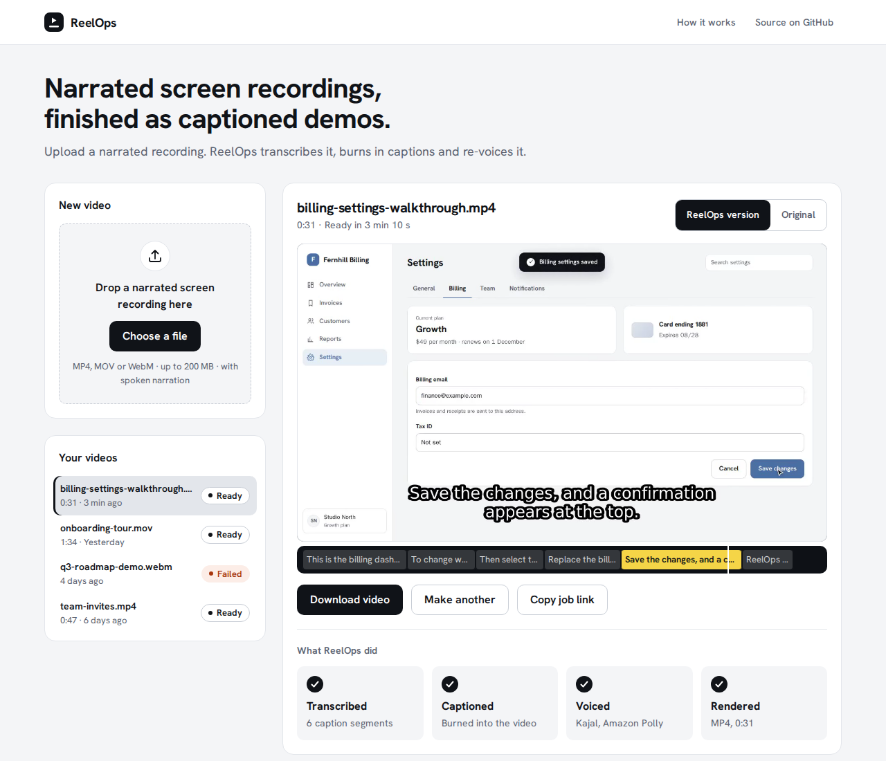
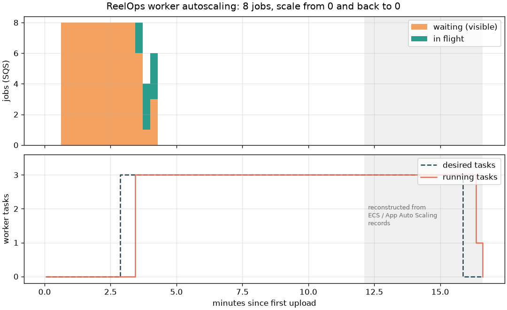

# ReelOps

Turn a screen recording into a captioned, AI-voiced demo video.

**Stack:** Python 3.12 · FastAPI · faster-whisper · Amazon Polly · ffmpeg · Docker ·
Terraform · AWS ECS Fargate · S3 · SQS · DynamoDB · GitHub Actions — region `ap-south-1`.

## Status

Phases 0–7 done: video pipeline worker, queue-driven API + worker, ECS Fargate
behind an ALB, worker autoscaling on SQS backlog (0–3 tasks), a web UI served
by the API, and CI/CD with GitHub Actions: lint, tests and Trivy scans on every
PR, a Terraform plan comment on PRs, and an approval-gated deploy from `main`
through GitHub OIDC (no stored AWS keys).

## Web UI

Upload a narrated recording and follow it through four steps (Uploaded,
Waiting for a worker, Processing, Ready). The finished video plays above a
caption track that lights the caption on screen, with a toggle to compare it
with the original. `?job=<id>` links reopen a job on any device. Uploads go
straight to S3 with a presigned URL; the API only handles small JSON.

*First visit at 1280 px: drop a narrated recording, and the four steps explain what happens next.*

## Autoscaling

The worker scales on the SQS backlog (waiting + in-flight jobs) from 0 to 3
Fargate tasks, and back to 0 after 10 idle minutes. Load test: 8 jobs submitted
to an idle stack (`scripts/load_test.sh`).

| Measurement | Result |
|---|---|
| First upload → first worker running (from 0) | 201.7 s (167 s CloudWatch/SQS metric delay, 35 s ECS + Fargate start) |
| Peak running workers | 3, at +204.5 s |
| All 8 jobs finished | 233.0 s after the first upload |
| Queue empty → desired 0 | 707.6 s (10-minute idle window + metric delay) |

Scaling the worker to zero means an idle ReelOps costs nothing for compute,
but the first job after a quiet period waits about 3 minutes before a worker
starts, mostly CloudWatch metric delay rather than Fargate start-up. For bursty
demo traffic that's a good trade; if first-job latency mattered, we'd keep one
warm worker during working hours or trigger scale-out directly from the API.

## Reliability

Failure drills against the live stack (`scripts/chaos/`, results in
[docs/failure-tests.md](docs/failure-tests.md)): a worker stopped or killed
mid-job, duplicate S3 events, unreadable uploads, an unprocessable message
(DLQ and email alarm), the API task replaced, and scale-in with task
protection. Jobs were never lost or duplicated; the drills found and fixed
three bugs (retry budget spent by harmless SQS receives, raw ffprobe errors
shown to users, an API blip shown as a failed job in the UI).

## Layout

| Path | Purpose |
|---|---|
| `app/` | FastAPI API |
| `worker/` | Transcription, voice-over and ffmpeg rendering |
| `frontend/` | Web UI |
| `terraform/bootstrap/` | One-time: Terraform state bucket (local state) |
| `terraform/main/` | All other infrastructure (remote state in S3) |
| `.github/workflows/` | CI/CD |
| `docs/` | Notes and diagrams |
| `samples/` | Sample inputs; `samples/output/` is git-ignored |
